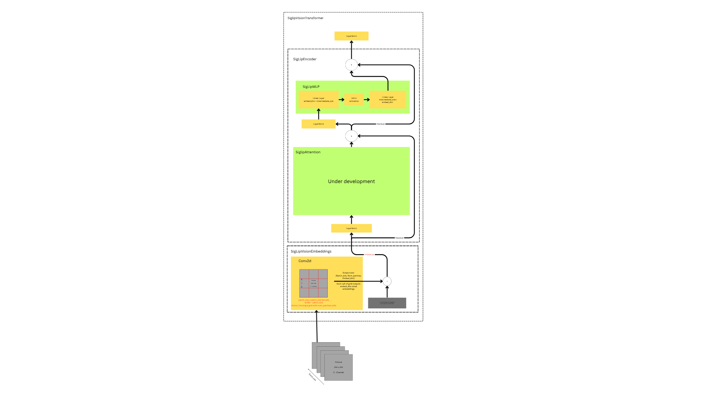

# Coding a VLM (Vision Language Model) - PaliGemma From scratch

Coding the PaliGemma model's architecture from Google's Gemma family, from scratch in pytorch, building both the SigLIP vision encoder and the Gemma-2B language model. PaliGemma combines these two components via a linear projection layer to produce a vision-language model, adding multimodal capabilities to the originally text-only Gemma architecture of early days.

More about PaliGemma: https://huggingface.co/blog/paligemma and https://github.com/google-research/big_vision/blob/main/big_vision/configs/proj/paligemma/README.md

## SigLip Vision Transformer Architecture (So Far)

